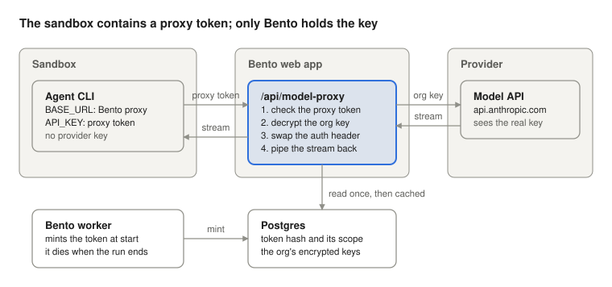

# Security

Agents read untrusted input (issues, READMEs, web pages, tool output), so Bento assumes any agent can be prompt injected. The sandbox is the boundary: an agent can run any command and read anything in its sandbox. What Bento controls is what the sandbox contains and what it can reach.

## Model keys stay encrypted in Bento

On hosted Bento (app.usebento.ai), and any other multi mode server, a sandbox never contains the organization's model API keys, and neither does a local Docker sandbox unless you turn the proxy off (see below). It contains a **proxy token** instead: a token minted for one agent session, under the same variable name as the key it replaces (`ANTHROPIC_API_KEY`, `OPENAI_API_KEY` and so on). The tool's base URL variable points at Bento's model proxy, so the agent sends its model calls to Bento with the proxy token, and Bento sends them on to the provider with the real key.

1. Bento mints a proxy token when the agent session starts, and keeps only its hash, with the list of keys it may use.
2. The agent calls `/api/model-proxy/<provider>` with the proxy token, in whichever header its tool sends a key in.
3. The proxy checks the token, decrypts the organization's key, swaps it in, and streams the request and the provider's answer through unchanged.
4. The proxy token stops working as soon as its agent session ends, however it ends.

A proxy token can do much less than a key:

| | Model API key | Proxy token |
| --- | --- | --- |
| Lifetime | Until someone rotates it | The agent session |
| Endpoints | The provider's whole API | Completions, token counting and model listings |
| Where it works | Anywhere | Only through Bento's proxy |
| If an agent prints it | The key is gone | Useless once the agent session ends |

A request for anything else in the provider's API (files, fine tuning, batches, account and admin endpoints) is refused.

Model providers' addresses come from Bento's list, not from the sandbox, so an agent cannot point the proxy, or your key, anywhere else.

A few setups still put a credential in the sandbox:

- harnesses with no base URL to point at Bento (Cursor, fx, Muse Code)
- custom provider keys and Ollama
- a saved base URL that is plain `http` or a private network address, which the proxy will not call on a multi mode server, so that key reaches the sandbox as it would without the proxy, and the run's transcript says so
- in local mode only, a Claude subscription login (hosted Bento does not offer subscription logins)

[agents.md](./agents.md#model-provider-keys-stay-out-of-agent-sandboxes) lists which keys each tool sends through the proxy.

**Local mode.** A local server proxies model calls from Docker sandboxes too, by default: the agent in the container gets a proxy token, and Bento, running on your machine, adds your key (from its own environment or from keys saved with `bento setup`) on the way to the provider. Turn it off in the Mac app under **Advanced settings, Model proxy**, or with `BENTO_MODEL_PROXY=false` for the terminal and the web UI. Either change takes effect when local Bento next starts. A hosted server cannot turn it off. Three local differences:

- With **Local process** (the local process driver) there is no sandbox and no proxy. Its agent runs as you, on your machine, and can read the same environment and files the key came from.
- Before a run's keys are swapped, its sandbox asks Bento's proxy for a readiness answer once, with a three second limit. A sandbox that cannot reach Bento keeps its keys for that agent session, and its transcript says so. Docker Desktop and OrbStack forward `host.docker.internal` to your machine's loopback, where local Bento listens; Docker on Linux does not, so a TUI or source install there falls back to raw keys unless `BENTO_MCP_GATEWAY_URL` names an address the sandbox can reach.
- A saved base URL that is plain `http` or on your network goes through the proxy, which calls it from your machine. One that names your machine itself (`localhost`, `127.0.0.1`, `host.docker.internal`) means something else inside the container, so that key and its base URL reach the sandbox as before, and the transcript says so.

An agent's model calls go through Bento, so a run left going in its container while local Bento is closed cannot reach its model until Bento starts again. Shared subscription credentials are still mounted read only and are never proxied, so the agent can read them.

## MCP credentials stay with Bento

MCP servers go through Bento's **MCP gateway** (`/api/mcp-gateway/<server>`), the model proxy's counterpart for tools: the agent's MCP config points every server, Bento's own tools and the team's and members' servers alike, at the gateway, with the agent session's proxy token. The gateway checks the token, attaches the server's credential, and calls the server from Bento's side. The sandbox never stores an MCP credential, and a server disabled mid run is refused on its next call. See [mcp.md](./mcp.md).

## Git access

On hosted Bento, git uses short lived GitHub App installation tokens, each scoped to one of the project's repositories, never the host's SSH keys or git config. The server mints them and uses them itself (to read a repository into the bundle a sandbox starts from, and to push), so they never enter the sandbox. See [pull-requests.md](./pull-requests.md).

## What a sandbox can reach

By default, the open internet, so agents can install packages and read docs.

An owner or admin can block it in **Settings, Team**. A blocked team's runs go to Modal, which allows only:

- Bento's own address, where the model proxy and the MCP gateway live
- the project's git remotes
- the hosts of model keys that are not proxied
- the team's **Allowed sites** (each team MCP server's host is added when it is enabled, and can be removed)

A blocked Modal run still attaches MCP servers, through the gateway.

**Docker deployments.** With the block on, Docker sandboxes use a network the operator creates (`BENTO_SANDBOX_RESTRICTED_NETWORK`), and Bento does not manage its rules. That network must let sandboxes reach Bento's address (`BENTO_MCP_GATEWAY_URL`, or `BETTER_AUTH_URL`; a `localhost` address is reached as `host.docker.internal`), because model calls go through the proxy there. Without that route, every blocked run fails at its first model call. The Allowed sites list does not apply to Docker, and blocked Docker runs attach no MCP servers. Setup: [web-app.md](./web-app.md#network-lock-on-docker).

## Billing when Bento fails

A run is billed unless Bento or its sandbox failed it. If the proxy itself fails a request (it cannot read or decrypt the key, or its own code fails) and the run then fails, the run is not billed. Once the provider answers a later request, the run is billed as usual. A provider that is down or slow is the provider's failure, as it is without the proxy.

## Good practice

- Never expose the host Docker socket, host SSH keys, or host git config to a sandbox.
- In local mode (hosted Bento offers no subscription logins), prefer API keys over mounting subscription credential files, so the key can go through the proxy.
- Keep a saved provider base URL on public `https`, for the same reason.
